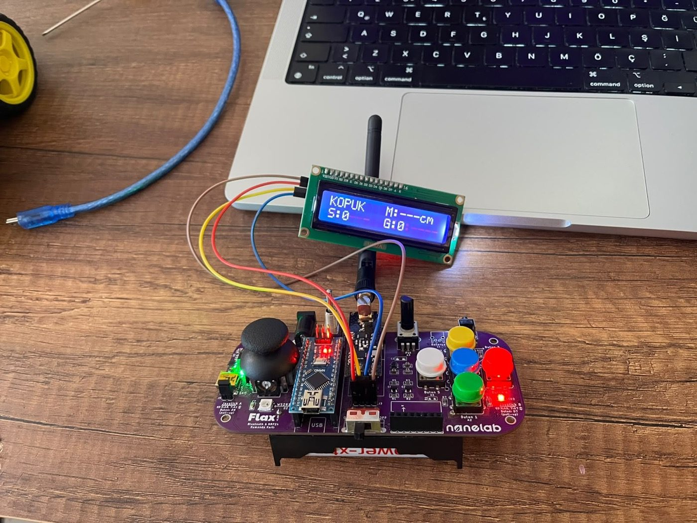
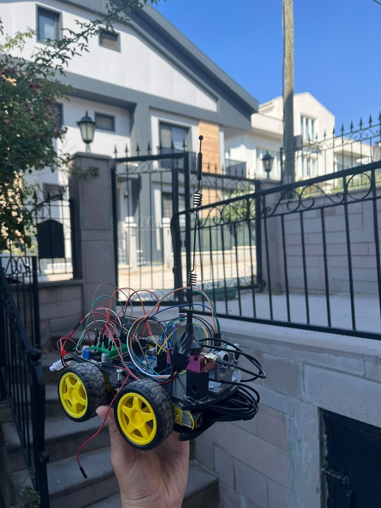
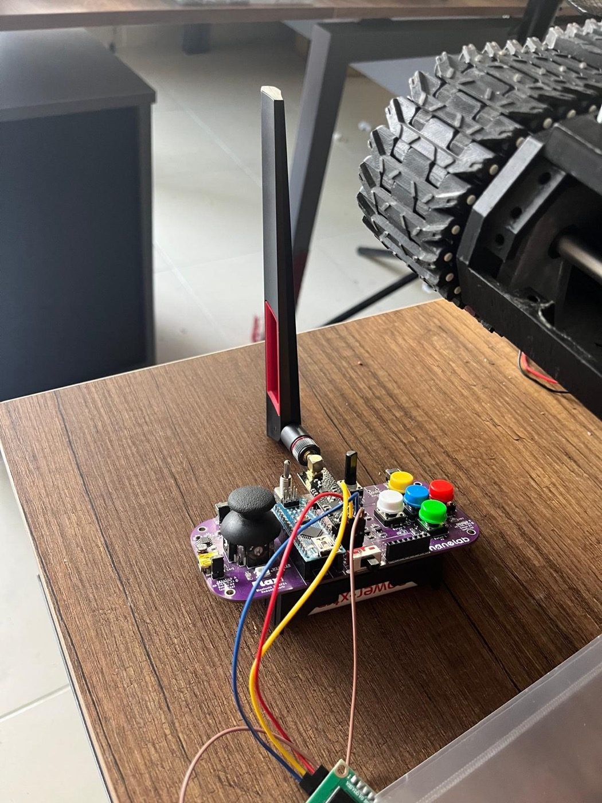
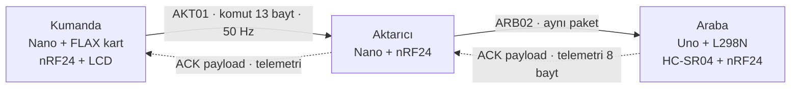

# Embedded nRF24 & Bluetooth RC System — "Venüs Araba"

İki (aktarıcıyla üç) Arduino arasında **gerçek zamanlı, hata toleranslı kablosuz kontrol**: joystick'li bir kumanda, 4 motorlu bir araba ve arada menzil uzatan bir aktarıcı. Proje önce **HC-05 Bluetooth** ile başladı, menzil için **nRF24L01+PA+LNA**'ya taşındı. Kodlar, bağlantı şemaları ve geliştirme sırasında yazılan tüm test sketch'leri bu depoda.

| Kumanda (FLAX kart + Nano + LCD) | Araba (Uno + L298N + HC-SR04) | Kumanda, antenli nRF24 ile |
|---|---|---|
|  |  |  |

## Ne yapıyor

- Kumanda joystick'i okur, diferansiyel sürüş karışımını hesaplar ve saniyede **50 komut paketi** yollar.
- Araba motorları **PWM rampası**, yön değişimi ölü zamanı ve aktif frenle sürer.
- **HC-SR04** ile engel algılar: 60 cm altında yavaşlar, 25 cm altında ileri gidişi keser (geri ve yerinde dönüş serbest).
- Araba kendi **besleme gerilimini** ölçer; anlık ve en düşük değer telemetriyle kumandanın **LCD**'sine gelir, dip değer EEPROM'a yazılır.
- **Failsafe:** 400 ms komut gelmezse araba frenler. Kumanda ya da aktarıcı kapanırsa da aynısı olur.
- Telemetri ayrı bir gönderim değil, nRF24'ün **ACK payload**'ı içinde döner.



Ortak radyo ayarı: kanal **108** (2508 MHz), **250 kbps**, `RF24_PA_MAX`, CRC-16, otomatik ACK.

## Depo yapısı

```
firmware/
  01-testler/            Donanımı tek tek doğrulayan küçük sketch'ler (HC-05 AT, STATE pini, nRF24 SPI kontrolü, LED ile ilk link...)
  02-bluetooth-hc05/     Bluetooth sürümü: verici/alici (v1) ve vericiRadarli/aliciRadarli (CRC-8 + telemetri + radar)
  03-nrf24-dogrudan/     nRF24, kumanda → araba doğrudan (Uno + joystick shield çifti ve FLAX kart çifti)
  04-nrf24-aktaricili/   SON SÜRÜM: kumanda → aktarıcı → araba
docs/
  elektrik.md            Malzeme listesi, pin tabloları, besleme mimarisi, sık yapılan hatalar
  protokol.md            Paket biçimleri (Bluetooth ve nRF24)
  cizimler/              Bağlantı şeması (SVG)
  fotolar/
```

## Hızlı başlangıç

1. Arduino IDE → Kütüphane Yöneticisi: **RF24** (TMRh20) ve **LiquidCrystal I2C** (Frank de Brabander).
2. Devreyi [docs/elektrik.md](docs/elektrik.md) içindeki tablolara göre kur.
3. `firmware/04-nrf24-aktaricili/` altındaki üç sketch'i yükle:

   | Sketch | Kart | Görev |
   |---|---|---|
   | `flaxKumandaliVerici` | Arduino Nano (FLAX kumanda kartı) | Kumanda |
   | `flaxAktarici` | Arduino Nano | Aktarıcı |
   | `flaxKumandaliAlici` | Arduino Uno | Araba |

4. Serial Monitor **115200 baud**. Her sketch açılışta donanımını test eder ve hatayı nedenleriyle birlikte yazar.

Aktarıcı kullanmayacaksan `03-nrf24-dogrudan/` altındaki `flaxKumandaliVerici` + `flaxKumandaliAlici` çiftini yükle (adres `ARB01`). Yeni bir nRF24 kurulumunda önce `01-testler/nrfKontrol` ile SPI bağlantısını doğrula.

> Kanal, veri hızı, adres ve `struct` tanımları tüm cihazlarda **birebir aynı** olmalı. 250 kbps yalnızca gerçek nRF24L01**+** çipinde çalışır; klon modülde iki tarafta da `RF24_1MBPS` yap.

## Geliştirme aşamaları

| # | Aşama | Öne çıkan |
|---|---|---|
| 1 | Kablolu test | Joystick + L298N + motorlar aynı kartta (`test_araba`) |
| 2 | HC-05 eşleştirme | AT komutlarıyla master/slave ayarı (`at_test`, `hc05_ayar`) |
| 3 | Bluetooth v1 | 7 baytlık çerçeveli paket, XOR checksum, 500 ms timeout |
| 4 | LCD + bağlantı tespiti | STATE pini olmadan, arabadan gelen heartbeat ile "bağlı/kopuk" |
| 5 | Kararlılık | CRC-8, sıra numarası, PWM rampası, Vcc izleme, regülatör |
| 6 | Radar | HC-SR04; SoftwareSerial'ın `pulseIn`'i bozduğu bulundu, HC-05 donanım UART'ına taşındı |
| 7 | nRF24'e geçiş | Elle yazılan çerçeveleme/CRC kalktı, telemetri ACK payload'a taşındı |
| 8 | FLAX kumanda kartı | Uno + shield yerine Nano tabanlı hazır kumanda kartı |
| 9 | Aktarıcı | Menzil için araya röle düğümü (`AKT01` → `ARB02`) |

## Doğrulama

Depodaki 24 sketch'in tamamı `arduino-cli` ile derlenir (AVR core, RF24 1.6.1, LiquidCrystal I2C 1.1.2). Son sürümün bellek kullanımı:

| Sketch | Kart | Flash | RAM |
|---|---|---|---|
| `flaxKumandaliVerici` | Nano | 13 398 B (%43) | 661 B (%32) |
| `flaxAktarici` | Nano | 6 958 B (%22) | 286 B (%13) |
| `flaxKumandaliAlici` | Uno | 8 918 B (%27) | 322 B (%15) |

```bash
arduino-cli compile --fqbn arduino:avr:uno firmware/04-nrf24-aktaricili/flaxKumandaliAlici
```

## Lisans

[MIT](LICENSE). Kod içi açıklamalar Türkçedir.
