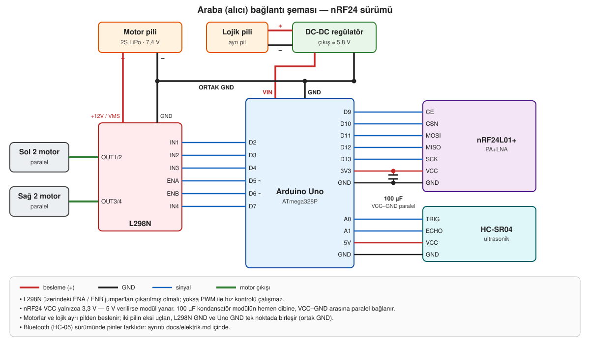

# Elektrik ve bağlantılar

## Malzeme listesi

| Parça | Adet | Nerede |
|---|---|---|
| Arduino Uno (ATmega328P) | 1 | Araba |
| Arduino Nano | 2 | Kumanda, aktarıcı |
| FLAX Bluetooth & NRF24 kumanda kartı (Nanelab) | 1 | Kumanda |
| nRF24L01+PA+LNA (SMA antenli) | 3 | Kumanda, aktarıcı, araba |
| L298N çift H-köprü motor sürücü | 1 | Araba |
| DC redüktörlü motor + teker | 4 | Araba (sol 2 / sağ 2 paralel) |
| HC-SR04 ultrasonik sensör | 1 | Araba |
| 16x2 LCD + I2C (PCF8574) arayüzü | 1 | Kumanda |
| Ayarlı DC-DC regülatör modülü | 1 | Araba, lojik beslemesi |
| 2S LiPo pil (7,4 V) | 1 | Araba, motorlar |
| Lojik için ayrı pil | 1 | Araba, Uno |
| 18650 pil | 1 | Kumanda kartı |
| Elektrolitik kondansatör 100 µF | nRF24 başına 1 | VCC–GND arası |
| HC-05 Bluetooth modülü | 2 | Yalnızca Bluetooth sürümü |

## Araba (alıcı)



### L298N

| L298N | Uno | Not |
|---|---|---|
| ENA | D5 (PWM) | Sol grup hız |
| IN1 | D2 | Sol grup yön |
| IN2 | D3 | Sol grup yön |
| ENB | D6 (PWM) | Sağ grup hız |
| IN3 | D4 | Sağ grup yön |
| IN4 | D7 | Sağ grup yön |
| OUT1 / OUT2 | — | Sol 2 motor, paralel |
| OUT3 / OUT4 | — | Sağ 2 motor, paralel |
| +12V (VMS) | — | Motor pili (+) |
| GND | GND | Motor pili (−) ve Uno GND ile ortak |

ENA ve ENB üzerindeki jumper'lar **çıkarılmış** olmalı; takılıyken sürücü hep tam hızda çalışır, PWM etkisiz kalır. Bir taraf ters dönüyorsa o motor grubunun iki ucunu yer değiştir ya da koddaki `solMotor()` / `sagMotor()` içinde `HIGH`/`LOW`'u değiştir.

### nRF24L01+PA+LNA

| nRF24 | Uno |
|---|---|
| CE | D9 |
| CSN | D10 |
| MOSI | D11 |
| MISO | D12 |
| SCK | D13 |
| IRQ | boş |
| VCC | **3,3 V** |
| GND | GND |

- VCC'ye 5 V verilirse modül yanar. Veri pinleri 5 V toleranslıdır, seviye dönüştürücü gerekmez.
- VCC–GND arasına, modülün hemen dibine **100 µF** kondansatör paralel bağlanır (uzun bacak VCC). Seri değil.
- Anten takılı değilken güç verme.

### HC-SR04

| HC-SR04 | Uno (nRF24 sürümü) | Uno (Bluetooth sürümü) |
|---|---|---|
| TRIG | A0 | D9 |
| ECHO | A1 | D8 |
| VCC | 5V | 5V |
| GND | GND | GND |

nRF24'e geçerken CE/CSN standart pinlerinde (D9/D10) kalsın diye radar A0/A1'e taşındı. D8 boştur.

### Besleme

Projede en çok vakit alan kısım beslemeydi. Son hali:

```
Motor pili (2S LiPo 7,4 V) ──────────────► L298N +12V
Lojik pili ──► DC-DC regülatör (≈5,8 V) ──► Uno VIN
                                            Uno 3V3 ──► nRF24 VCC  (+100 µF)
                                            Uno 5V  ──► HC-SR04 VCC
Tüm GND'ler ortak
```

Buraya nasıl gelindi:

1. **Tek pil, regülatörsüz.** Motorlar kalkışta akım çekince gerilim çöküyor, HC-05 bağlantısı kopuyordu. Kopmanın güç kaynaklı olduğunu görmek için araba kendi Vcc'sini ölçüp en düşük değeri kumandanın ekranına yollayacak şekilde yazıldı (`okuVcc()`, dahili 1,1 V bandgap referansı; ek donanım yok). Kopma anındaki dip değer sorunu doğruladı.
2. **Regülatör eklendi.** Lojik beslemesi regülatör üzerinden verilince masada çalışan sistem sahada da çalıştı. Yazılım tarafında PWM rampası ve yön değişiminde 70 ms ölü zaman akım tepelerini düşürdü.
3. **nRF24'e geçiş.** İlk kurulumda pilden üç kol çıkıyordu: L298N, regülatör → Uno VIN ve ayrı bir 3,3 V regülatör → nRF24. Sistem bir gün çalışıp sonraki gün çalışmayınca ayrı 3,3 V regülatör kaldırıldı, modül kondansatörle birlikte Uno'nun 3V3 pinine alındı.
4. **Motorlar ayrı pile.** Motor akımı lojik tarafı hâlâ etkilediği için motorlar kendi 2S LiPo'suna, Uno ayrı bir pile bağlandı.

Notlar:

- Uno'nun VIN girişi kart üstü regülatörden geçer. VIN'e ≈5,8 V verildiğinde 5V hattı 5 V'un altında kalabilir; yazılım Vcc'yi sürekli izler, **4600 mV altı** beslemenin çöktüğü anlamına gelir.
- PA+LNA modül gönderim tepesinde ~115 mA çeker, Uno'nun 3V3 çıkışı sınırlıdır. Kondansatör tepeleri karşılar; yine de kopma yaşanırsa ayrı bir 3,3 V regülatör ya da nRF24 adaptör kartı kullan.
- Masada `RF24_PA_MAX` ile modüller yan yanayken alıcı doyar ve paket gitmez. En az 2–3 m ara bırak ya da testte `RF24_PA_LOW` kullan.

## Kumanda (verici)

Son sürüm, Nano'nun takıldığı hazır **FLAX kumanda kartını** kullanır; nRF24 kartın kendi soketine, LCD ise J3 (I2C) konnektörüne bağlanır.

| İşlev | Nano pini | Durum |
|---|---|---|
| Joystick X / Y | A0 / A1 | Kullanılıyor |
| Joystick butonu | D5 | — |
| Potansiyometre | A3 | `POT_KULLAN` ile açılır |
| Buton 1 / 2 / 4 | A2 / D6 / D7 | `BUTON_KULLAN` ile açılır |
| Buton 3 / 5 | A7 / A6 | Yalnızca analog okunur (`analogRead(...) < 500`) |
| Buton A / B | D0 / D1 | **Kullanılmıyor**: donanım seri portu |
| WS2812 RGB LED | D2 | — |
| I2C (LCD, MPU6050) | A4 = SDA, A5 = SCL | LCD adresi `0x27` (bazı modüllerde `0x3F`) |
| nRF24 CE / CSN | aktarıcılı sürümde D10 / D9, doğrudan sürümde D9 / D10 | Koddaki `CE_PIN` / `CSN_PIN` |
| nRF24 SPI | D11 / D12 / D13 | Sabit |

Besleme: 18650 pille çalışırken JP5 jumper'ı takılı, 6–9 V harici girişte çıkarılmış olmalı. Pil ters takılırsa kart kalıcı hasar alır.

Önceki sürümlerde kumanda **Arduino Uno + joystick shield** idi: joystick A0/A1, LCD A4/A5, nRF24 shield'in 8 pinli soketinde (`vericiNrf`), Bluetooth sürümünde HC-05 donanım seri portunda (D0/D1).

## Aktarıcı

Yalnızca Nano + nRF24L01+PA+LNA. Bağlantı arabadaki nRF24 tablosuyla aynıdır (CE D9, CSN D10, SPI D11–D13, 3,3 V + kondansatör). Kumanda ile arabanın arasına, olabildiğince yükseğe konur; antenler dik ve birbirine paralel durmalıdır.

## Bluetooth (HC-05) sürümü

| Sketch | HC-05 TXD → | HC-05 RXD → | Seri |
|---|---|---|---|
| `alici` (araba, v1) | D10 | D11 | SoftwareSerial, 9600 |
| `aliciRadarli` (araba) | D0 (RX) | D1 (TX) | Donanım UART, 9600 |
| `verici`, `vericiRadarli` (kumanda) | D0 (RX) | D1 (TX) | Donanım UART, 9600 |

- HC-05 VCC 5 V'tan beslenir; Uno TX → HC-05 RXD hattında gerilim bölücü vardır (5 V → 3,3 V).
- HC-05 donanım seri portundayken **kod yüklerken modülü çıkar**.
- Eşleştirme AT modunda (38400 baud) yapılır: `01-testler/hc05_ayar`.
- Radar eklenince HC-05 pin 10/11'den 0/1'e taşındı: SoftwareSerial bayt alırken kesmeleri kapattığı için `pulseIn()` ölçümleri bozuluyordu.

## Sık yapılan hatalar

| Belirti | Olası neden |
|---|---|
| `HATA 1: nRF24 modulu hic yanit vermiyor` | Yanlış pin, temassız jumper, 3,3 V yok |
| Modül bulunuyor ama paket gitmiyor | Kanal / adres / veri hızı / `struct` iki tarafta farklı; modüller çok yakın |
| Motor çalışınca bağlantı kopuyor | Besleme çöküyor: kondansatör yok, motor ve lojik aynı pilde |
| Hız kontrolü yok, motor hep tam hız | L298N ENA/ENB jumper'ları takılı |
| LCD karanlık | I2C adresi `0x3F` olabilir; arkadaki kontrast trimpotunu çevir |
| Kod yüklenmiyor (Bluetooth sürümü) | HC-05 D0/D1'de takılı |
